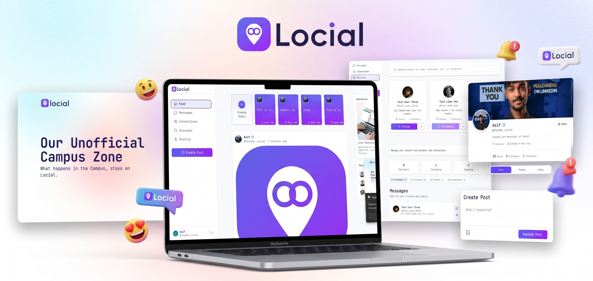

# Locial - Stay Connected
 
A full-stack social media web app where people can share posts and stories, follow each other, send connection requests, discover new people and chat in real time.
 
Built with **React**, **Express**, **MongoDB**, **Clerk**, **Inngest** and **ImageKit**.
 
---

---
 
## Screenshots
 
📸 Application Preview: A sneak peek into Locial's user interface, including the Feed, Discover, Connections, Chat, and Profile pages.
 

 
---
 
## Table of Contents
 
- [Features](#features)
- [Tech Stack](#tech-stack)
- [Project Structure](#project-structure)
- [Getting Started](#getting-started)
- [Environment Variables](#environment-variables)
- [API Reference](#api-reference)
- [Background Jobs (Inngest)](#background-jobs-inngest)
- [Deployment](#deployment)
- [Known Limitations](#known-limitations)
- [Roadmap](#roadmap)
- [Author](#author)
---
 
## Features
 
**Authentication**
- Sign up and login with Clerk (email and social login)
- Clerk users are synced to MongoDB automatically through Inngest (create, update, delete)
**Feed and Posts**
- Create text, image or text-with-image posts (up to 4 images)
- Hashtags are highlighted in the post content
- Like and unlike posts
- Feed shows posts from you, your connections and the people you follow
**Stories**
- Create text stories (with background colour) or photo/video stories
- Stories are deleted automatically after 24 hours (Inngest)
**Network**
- Discover people by name, username or location
- Follow and unfollow users
- Send connection requests and accept them
- Connections page with Followers, Following, Pending and Connections tabs
- Email notification and a 24-hour reminder for pending connection requests
**Chat**
- One-to-one chat between connections
- Send text and images
- Live messages using Server-Sent Events (SSE)
- Daily email digest for unseen messages
**Profile**
- View your own or someone else's profile and posts
- Edit name, username, bio, location, profile photo and cover photo
- Media tab shows all images from a user's posts
**Other**
- Fully responsive layout
- Toast notifications for every action
- Rate limiting and basic privacy protection (emails are never sent to other users)
---
 
## Tech Stack
 
| Layer | Technology |
|---|---|
| Frontend | React (Vite), React Router, Redux Toolkit, Tailwind CSS, Axios, Lucide Icons, react-hot-toast, Moment.js |
| Backend | Node.js, Express 5, Mongoose, Multer |
| Database | MongoDB Atlas |
| Auth | Clerk |
| Background jobs | Inngest |
| Image storage | ImageKit |
| Email | Nodemailer with Brevo SMTP |
| Hosting | Vercel |
 
---
 
## Project Structure
 
```
locial_prod/
├── Backend/
│   ├── configs/
│   │   ├── db.js              # MongoDB connection
│   │   ├── imagekit.js        # ImageKit client
│   │   ├── multer.js          # File upload config (size and type limits)
│   │   └── nodemailer.js      # Email sender (Brevo SMTP)
│   ├── controllers/
│   │   ├── userController.js
│   │   ├── postController.js
│   │   ├── storyController.js
│   │   └── messageController.js
│   ├── inngest/
│   │   └── index.js           # Inngest client and all background functions
│   ├── middlewares/
│   │   └── auth.js            # protect middleware (Clerk)
│   ├── routes/
│   │   ├── userRoutes.js
│   │   ├── postRoutes.js
│   │   ├── storyRoutes.js
│   │   └── messageRoutes.js
│   ├── src/models/
│   │   ├── User.js
│   │   ├── Post.js
│   │   ├── Story.js
│   │   ├── Connection.js
│   │   └── Message.js
│   └── server.js
│
└── Frontend/
    └── src/
        ├── api/axios.js       # Axios instance
        ├── app/store.js       # Redux store
        ├── assets/
        ├── Components/        # Sidebar, PostCard, StoriesBar, UserCard, ...
        ├── features/          # Redux slices (user, connections, messages)
        ├── Pages/             # Feed, Discover, Connections, Messages, ChatBox, Profile, CreatePost
        ├── App.jsx
        └── main.jsx
```
 
---
 
## Getting Started
 
### Prerequisites
 
- Node.js 20 or newer
- A MongoDB Atlas cluster
- A Clerk application
- An ImageKit account
- An Inngest account (optional for local development)
- A Brevo account for SMTP (optional, only needed for emails)
### 1. Clone the repository
 
```bash
git clone https://github.com/<your-username>/<your-repo>.git
cd <your-repo>
```
 
### 2. Backend setup
 
```bash
cd Backend
npm install
```
 
Create a `.env` file (see [Environment Variables](#environment-variables)), then start the server:
 
```bash
npm run server
```
 
The API runs on `http://localhost:4000`.
 
### 3. Frontend setup
 
```bash
cd Frontend
npm install
npm run dev
```
 
The app runs on `http://localhost:5173`.
 
### 4. Inngest dev server (for background jobs)
 
In a new terminal:
 
```bash
npx inngest-cli@latest dev -u http://localhost:4000/api/inngest
```
 
Open `http://localhost:8288` to see your functions and test runs.
 
---
 
## Environment Variables
 
### Backend (`Backend/.env`)
 
```env
PORT=4000
MONGODB_URI=mongodb+srv://<user>:<password>@<cluster>.mongodb.net
 
CLERK_PUBLISHABLE_KEY=pk_test_...
CLERK_SECRET_KEY=sk_test_...
 
IMAGEKIT_PRIVATE_KEY=private_...
IMAGEKIT_URL_ENDPOINT=https://ik.imagekit.io/<your_id>
 
# Local development only. Do NOT set this in production.
INNGEST_DEV=1
 
# Production only
INNGEST_SIGNING_KEY=
INNGEST_EVENT_KEY=
 
SMTP_USER=
SMTP_PASSWORD=
SENDER_EMAIL=
 
FRONTEND_URL=http://localhost:5173
```
 
> `MONGODB_URI` must not end with `/` or contain a database name. The app adds `/Locial` itself.
 
### Frontend (`Frontend/.env`)
 
```env
VITE_CLERK_PUBLISHABLE_KEY=pk_test_...
VITE_BASEURL=http://localhost:4000
```
 
> Never commit `.env` files. Both are already listed in `.gitignore`.
 
---
 
## API Reference
 
All routes except the SSE stream require a Clerk token:
 
```
Authorization: Bearer <token>
```
 
Every response has the shape `{ success: boolean, message?: string, ... }`.
 
### User - `/api/user`
 
| Method | Route | Description |
|---|---|---|
| GET | `/data` | Get the logged-in user |
| POST | `/update` | Update profile (form-data: `profile`, `cover`, text fields) |
| POST | `/discover` | Search users `{ input }` |
| POST | `/follow` | Follow a user `{ id }` |
| POST | `/unfollow` | Unfollow a user `{ id }` |
| POST | `/connected` | Send a connection request `{ id }` |
| POST | `/accept` | Accept a connection request `{ id }` |
| GET | `/connections` | Get connections, followers, following and pending requests |
| POST | `/profiles` | Get a profile and its posts `{ profileId }` |
 
### Post - `/api/post`
 
| Method | Route | Description |
|---|---|---|
| POST | `/add` | Create a post (form-data: `content`, `post_type`, `images`) |
| GET | `/feed` | Get feed posts |
| POST | `/like` | Like or unlike a post `{ postId }` |
 
### Story - `/api/story`
 
| Method | Route | Description |
|---|---|---|
| POST | `/create` | Create a story (form-data: `content`, `media_type`, `background_color`, `media`) |
| GET | `/get` | Get stories from you, your connections and followings |
 
### Message - `/api/message`
 
| Method | Route | Description |
|---|---|---|
| GET | `/:userId` | Open the SSE stream for live messages (no token needed) |
| POST | `/send` | Send a message (form-data: `to_user_id`, `text`, `image`) |
| POST | `/get` | Get a chat `{ to_user_id }` |
| GET | `/recent` | Get recent messages |
 
---
 
## Background Jobs (Inngest)
 
Served at `/api/inngest`.
 
| Function | Trigger | What it does |
|---|---|---|
| `sync-user-from-clerk` | `clerk/user.created` | Creates the user in MongoDB with a unique username |
| `update-user-from-clerk` | `clerk/user.updated` | Updates name, email and photo |
| `delete-user-from-clerk` | `clerk/user.deleted` | Removes the user |
| `send-new-connection-request-remainder` | `app/connection-request-remainder` | Emails the receiver, waits 24 hours and sends a reminder if still pending |
| `story-delete` | `app/story.delete` | Deletes a story 24 hours after it was created |
| `send-unseen-messages-notification` | Cron, every day at 9 AM | Emails users who have unseen messages |
 
To sync Clerk users, connect Clerk to Inngest from the Inngest dashboard (Integrations, then Clerk) so that `clerk/*` events are forwarded.
 
---
 
## Deployment
 
The backend exports the Express `app` and only calls `listen()` outside Vercel, so it runs as a serverless function.
 
1. Push the code to GitHub.
2. Import the repo on Vercel. Set the **Root Directory** to `Backend` (and create a second project for `Frontend`).
3. Add all backend environment variables in the Vercel dashboard. Do **not** add `INNGEST_DEV`.
4. Redeploy after adding or changing any variable.
5. In the Inngest dashboard, sync your app with `https://<your-backend>.vercel.app/api/inngest`. You should see all 6 functions.
6. In MongoDB Atlas, allow `0.0.0.0/0` under Network Access.
7. Set `FRONTEND_URL` to your deployed frontend URL (no trailing slash) so CORS allows it.
8. Set `VITE_BASEURL` in the frontend project to your backend URL.
9. Switch Clerk from development keys to a production instance before going live.
---
 
## Known Limitations
 
- **Live chat on Vercel:** SSE connections do not stay open on serverless functions, so live messages only work locally or on a long-running server (Render, Railway). Messages still send and load normally on Vercel after a refresh.
- **File size:** Uploads are limited to 4 MB because of Vercel's request body limit.
- **Real-time presence:** There is no online status or typing indicator yet.
---
 
## Roadmap
 
- [ ] Real-time chat with Pusher or Ably (works on serverless)
- [ ] Comments on posts
- [ ] Video posts with direct-to-ImageKit uploads
- [ ] Unread message badge and in-app notifications
- [ ] Pagination and infinite scroll for the feed
- [ ] Block and report users
---
 
## Screenshots
 
Add screenshots of the Feed, Discover, Connections, Chat and Profile pages here.
 

 
---
 
## Author
 
**Sekh Asif**
 
- GitHub: [@your-username](https://github.com/seaikh91-Asif)
- LinkedIn: [your-profile](https://www.linkedin.com/in/sekh-asif-dev/)
If you like this project, give it a star.